<div align="center">


# Sentinel

**Self-hosted remote control and monitoring for your own Windows PC — from your phone or wrist.**

Lock it, watch it, message it, and get it back — without a cloud account.

[](#requirements)
[](#1-windows-agent)
[](#2-relay-server)
[](#3-phone-app)
[](#4-wear-os-app)
[](#6-flipper-zero-optional)
[](https://github.com/WhatAVibe/Sentinel/releases/latest)
[](#versioning)
[](LICENSE)

[Download](#download) · [Quick start](#quick-start) · [Screenshots](#screenshots) · [Security](#security-model) · [Customization](#customization) · [Docs](#documentation) · [Troubleshooting](#troubleshooting)

</div>

> [!IMPORTANT]
> **Sentinel is remote-administration software for devices you own.** Install it only on your own PC and
> phones. It has no stealth mode: the tray icon, dashboard, logs and settings are always visible. Monitoring
> another person without their knowledge is illegal in most places — don't.

---

## Download

Everything ships from **[Releases](https://github.com/WhatAVibe/Sentinel/releases/latest)**. The builds are
unsigned; Windows SmartScreen will ask you to confirm the publisher.

| Platform | File | Notes |
|---|---|---|
| **Windows 10/11 x64** | [Sentinel-Setup-3.0.0.exe](https://github.com/WhatAVibe/Sentinel/releases/latest/download/Sentinel-Setup-3.0.0.exe) | Installer with the self-contained agent 2.0.0, QR pairing, Update/Repair and an agent-based uninstaller. Recommended. |
| Windows (agent only) | [Sentinel-Agent-2.0.0-win-x64.exe](https://github.com/WhatAVibe/Sentinel/releases/latest/download/Sentinel-Agent-2.0.0-win-x64.exe) | Portable single file; no installer, keeps `%APPDATA%\Sentinel` |
| **Android 8.0+** | [Sentinel-Phone-2.0.0.apk](https://github.com/WhatAVibe/Sentinel/releases/latest/download/Sentinel-Phone-2.0.0.apk) | Flutter phone app |
| Wear OS 3+ (API 30) | [Sentinel-Watch-2.0.0.apk](https://github.com/WhatAVibe/Sentinel/releases/latest/download/Sentinel-Watch-2.0.0.apk) | Companion watch app, four tiles and complications |
| Relay server | [Sentinel-Relay-2.0.0.zip](https://github.com/WhatAVibe/Sentinel/releases/latest/download/Sentinel-Relay-2.0.0.zip) | Flask + SQLite relay source; Python 3.10+ |
| Flipper Zero | [Sentinel-Flipper-1.1.0.fap](https://github.com/WhatAVibe/Sentinel/releases/download/flipper-v1.1.0/Sentinel-Flipper-1.1.0.fap) | Separate `flipper-v1.1.0` release (BLE bridge) |
| Checksums | [SHA256SUMS.txt](https://github.com/WhatAVibe/Sentinel/releases/latest/download/SHA256SUMS.txt) | Verify with `sha256sum -c SHA256SUMS.txt` |

Install the phone app with `adb install -r Sentinel-Phone-2.0.0.apk`, or open the APK on the phone. The watch
app goes over Wireless debugging: `adb connect <watch-ip>:<port>` then `adb install -r
Sentinel-Watch-2.0.0.apk`. The relay is a plain folder — unzip it and follow
[Quick start](#1-relay-server) below.

---

## Why Sentinel

Windows has Remote Desktop. It doesn't give you a live 2FA-gated lock screen, a screenshot trail of who used
your PC while you were out, or a "who is at the keyboard right now" view from your watch.

Sentinel is a small, self-hosted alternative built around three ideas:

1. **Outbound only.** The PC connects to *your* relay; nothing needs port-forwarding at home.
2. **The second factor is real.** Disarming away mode, releasing the secure lock, removing a phone, or
   exiting the agent all require a TOTP code that the PC verifies *locally* as well as on the server.
3. **It tells you what happened.** Power events, failed codes, remote actions and away-mode activity are
   logged and pushed to your phone.

No accounts, no subscriptions, no telemetry. One Flask process, one SQLite file, and your devices.

---

## Screenshots

### Phone

<table>
  <tr>
    <td width="50%">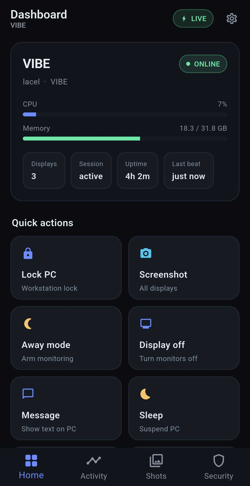</td>
    <td width="50%">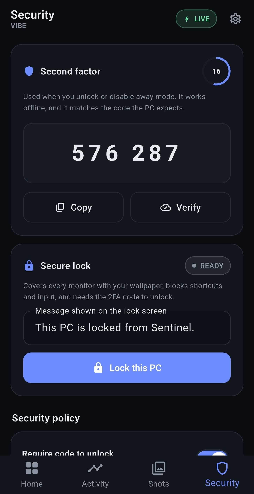</td>
  </tr>
  <tr>
    <td align="center"><sub><b>Live dashboard</b> — CPU/RAM, session, quick actions</sub></td>
    <td align="center"><sub><b>Security tab</b> — live TOTP, secure lock, policy</sub></td>
  </tr>
</table>

### Windows agent

<table>
  <tr>
    <td width="60%">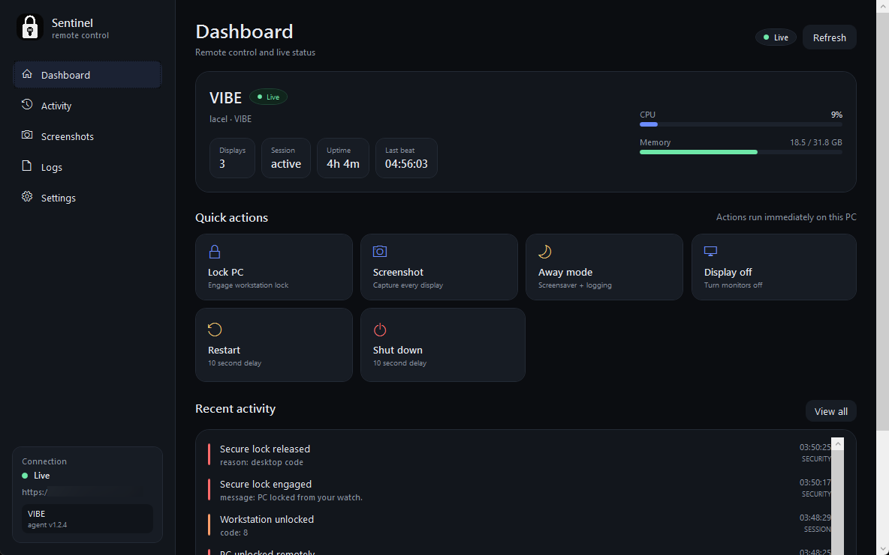</td>
    <td width="40%">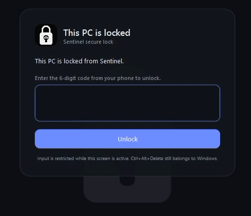</td>
  </tr>
  <tr>
    <td align="center"><sub><b>Agent dashboard</b> — status, actions, activity feed</sub></td>
    <td align="center"><sub><b>Secure lock</b> — 2FA overlay on every monitor</sub></td>
  </tr>
</table>

### Wear OS

<table>
  <tr>
    <td width="50%">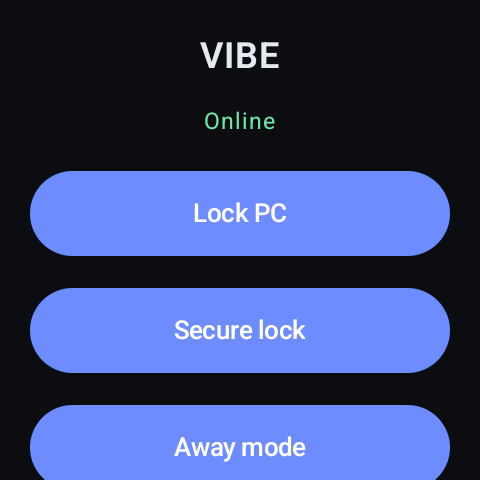</td>
    <td width="50%">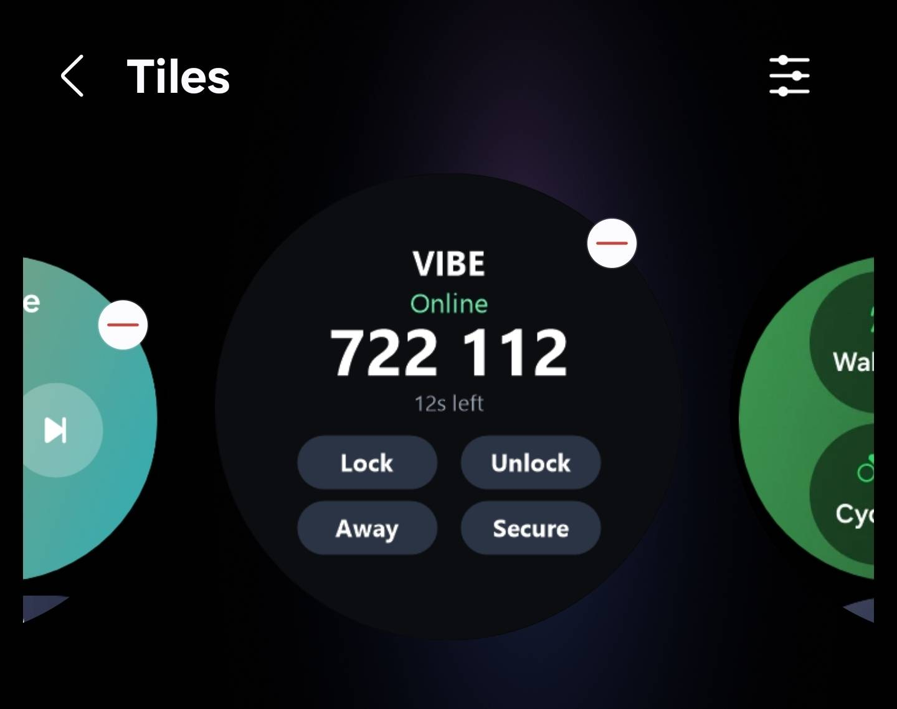</td>
  </tr>
  <tr>
    <td align="center"><sub><b>Watch app</b> — one-tap lock, secure lock, away</sub></td>
    <td align="center"><sub><b>All-in-one tile</b> — status, code, buttons</sub></td>
  </tr>
</table>

### More settings

<table>
  <tr>
    <td width="50%">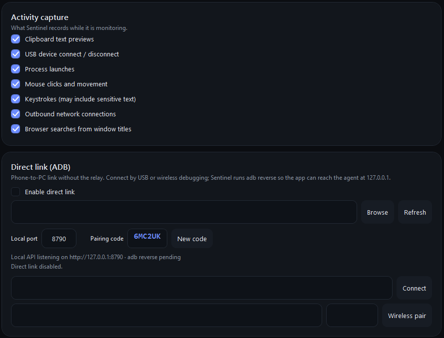</td>
    <td width="50%">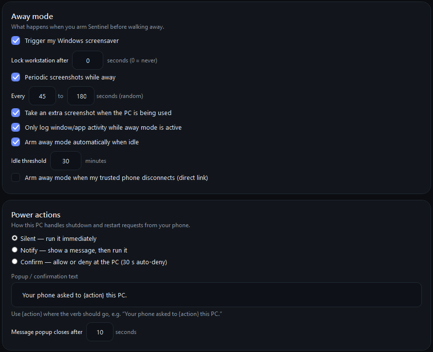</td>
  </tr>
  <tr>
    <td align="center"><sub><b>Activity capture</b> + direct ADB link</sub></td>
    <td align="center"><sub><b>Away mode</b> + power policy</sub></td>
  </tr>
</table>

### Flipper Zero

<table>
  <tr>
    <td width="33%">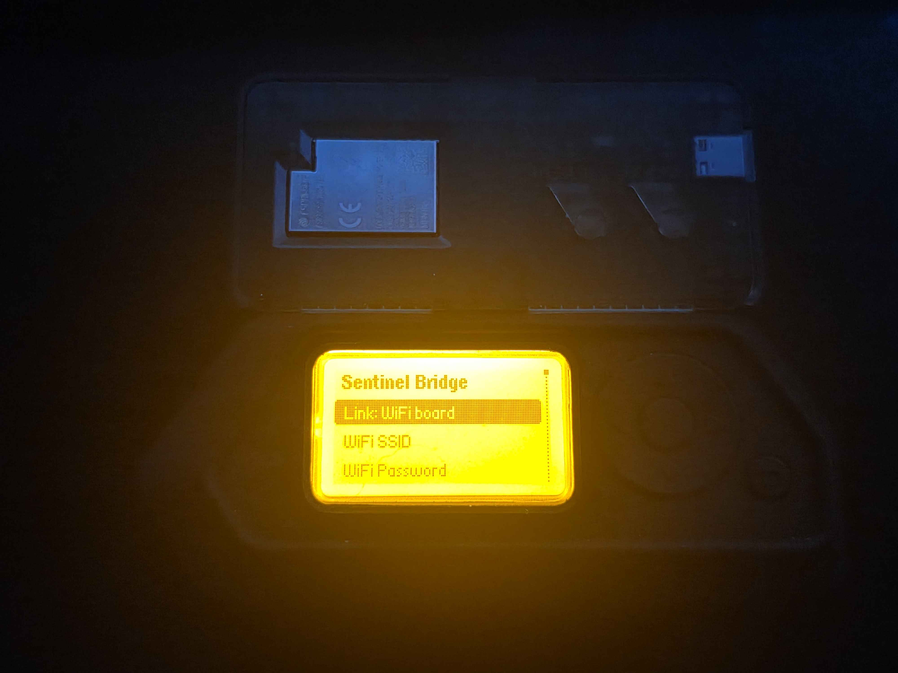</td>
    <td width="33%">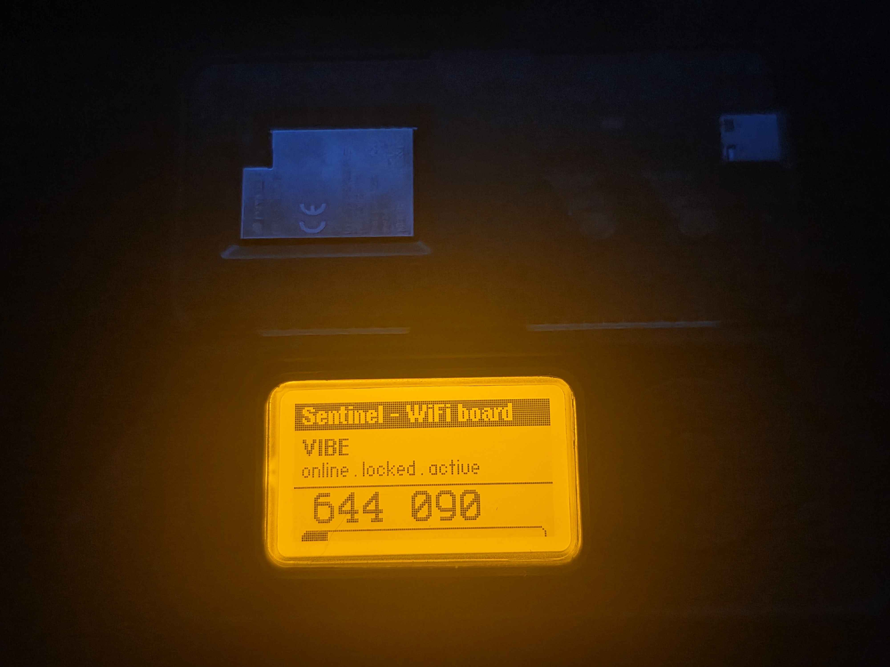</td>
    <td width="33%">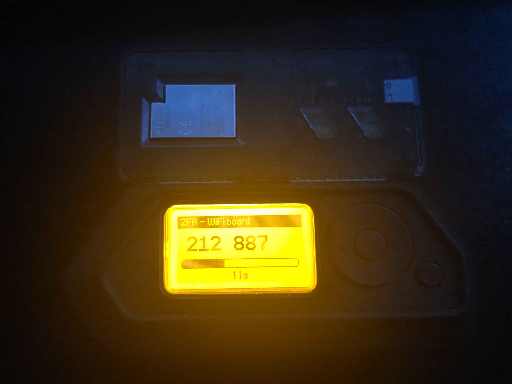</td>
  </tr>
  <tr>
    <td align="center"><sub><b>Menu</b> — transport and actions</sub></td>
    <td align="center"><sub><b>Status</b> — name, state, code</sub></td>
    <td align="center"><sub><b>2FA</b> — code, bar, seconds</sub></td>
  </tr>
</table>

---

## Features

| | |
|---|---|
| **Remote control** | Lock, secure lock, display off/on, sleep, restart, shut down, cancel shutdown, ring |
| **Screenshots** | Capture every monitor at once, browse the gallery, delete remotely |
| **Messages** | Styled toast / dialog / alert / banner, fullscreen takeover, reply from the PC |
| **Away mode** | Screensaver, optional lock delay, random-interval screenshots, extra shots on activity |
| **2FA everywhere** | TOTP gates unlock, disarm, secure-lock release, phone removal and agent exit |
| **Clipboard push** | Tap the live code on the phone or watch to put it on the PC clipboard, then Ctrl+V |
| **Hardware key** | Link a FIDO2 key (YubiKey, Flipper) and unlock locally with a touch |
| **Secure lock** | Full-desktop 2FA lock that swallows shortcuts and input until the code is entered |
| **Watchdog** | Detached supervisor relaunches the agent after an unauthorized kill |
| **Multiple PCs** | Pair several PCs, switch between them, give each a local name |
| **Server-side history** | Full event timeline and screenshot archive live on the relay, paged oldest-first |
| **Power alerts** | "Went offline", "back online" with downtime, "restarted" on uptime reset |
| **Activity log** | Windows, apps, network, searches, mouse/keyboard, clipboard, USB, sessions, security |
| **Wear OS** | Quick actions, live code, four tiles including a configurable all-in-one, and a live complication |
| **Home automation** | REST + WebSocket relay API with the full action surface |
| **Metrics** | CPU, memory, free disk space and laptop battery/charging, with low-disk and low-battery alerts |
| **Export** | Activity and audit history as JSON or CSV, from the phone |
| **Docker / backups** | `docker compose up -d` relay and an online SQLite backup tool with retention |
| **Widgets** | Android status, code and quick-action widgets plus a Quick Settings lock tile |
| **Locked desktop** | Away mode and secure lock hide the dashboard; tray management is disabled until the 2FA code is entered |
| **Flipper Zero** | Lock, secure lock, away mode, screenshot and the live code, over BLE with the phone as the network |
| **Phone management** | List, inspect and revoke linked phones from either side |
| **No cloud** | Bearer tokens, hashed server-side, DPAPI on Windows, Keystore on Android |
| **E2E encrypted** | Events, messages and screenshots are AES-256-GCM encrypted on the PC; the relay never sees the key |

---

## How it works

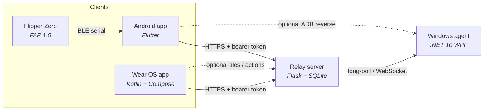

- The **agent** holds the TOTP secret, validates codes a second time locally, and executes commands.
- The **relay** stores devices, phones, events, messages and screenshots. It never gets your Windows
  password and cannot unlock the PC on its own.
- The **phone/watch** never talk to the PC directly unless you enable the optional ADB direct link.
- The **Flipper** has no network of its own: it talks to the phone over Bluetooth and the phone relays its
  commands, so the relay token and TOTP secret never leave the phone.

---

## End-to-end encryption

Since **3.0.0**, events, messages and screenshots are encrypted on the PC with a per-PC 32-byte data key
(AES-256-GCM, AAD-bound per record type). The key is delivered to a phone only through the **pairing QR** and
to the watch only through the phone over Bluetooth. The relay stores ciphertext and never receives the key,
so a relay operator — including someone hosting a relay for other people — cannot read your activity,
messages or screenshots.

- Pairing is QR-based for encrypted devices. Typing a URL + 6-character code cannot carry a key without
  handing it to the relay, so the phone refuses that path for encrypted PCs.
- The watch is added from the phone: **Settings → Pair a Wear OS watch**, which asks the relay for a
  companion token and sends URL/token/secret/key over the Wear OS Data Layer. No watch keyboard.
- The relay only sees routing metadata: device name, timestamps, event category/severity, message
  direction/status, screenshot size/dimensions/count, and relay-generated system alerts (offline, low disk,
  low battery). See [docs/ENCRYPTION.md](docs/ENCRYPTION.md) and [docs/SECURITY.md](docs/SECURITY.md).

---

## Requirements

| Component | Needs |
|---|---|
| Relay | Python 3.10+ (tested on 3.14), Flask 3, any small Linux box / VPS / always-on PC |
| Agent | Windows 10/11 x64, .NET 10 SDK (or Visual Studio 2026 with the .NET desktop workload) |
| Phone app | Flutter (Dart 3.13+), Android SDK; runs on Android 8.0+ |
| Watch app | Android SDK 36, JDK 17+, Gradle wrapper included; Wear OS 3+ (API 30) |
| Flipper app | Flipper Zero on stock firmware (API 87.1+), `ufbt`; no WiFi board needed |
| Network | LAN, [Tailscale](https://tailscale.com/), or HTTPS via a tunnel/reverse proxy |

---

## Quick start

Four pieces, in this order. Full details and platform notes are in **[docs/SETUP.md](docs/SETUP.md)**.

### 1. Relay server

On the machine that will always be on (Linux example):

```bash
sudo mkdir -p /opt/sentinel
sudo chown "$USER" /opt/sentinel
# copy the repository's server/ folder into /opt/sentinel
cd /opt/sentinel
python3 -m venv .venv
.venv/bin/pip install -r requirements.txt
cp config.example.json config.json
```

Create `/etc/systemd/system/sentinel.service`:

```ini
[Unit]
Description=Sentinel relay
After=network-online.target

[Service]
WorkingDirectory=/opt/sentinel
ExecStart=/opt/sentinel/.venv/bin/python /opt/sentinel/server.py
Restart=always
RestartSec=5
User=sentinel
# The relay keeps a small SQLite pool; give it headroom so a burst of
# reconnects can never exhaust file descriptors.
LimitNOFILE=65536

[Install]
WantedBy=multi-user.target
```

```bash
sudo useradd -r -s /bin/false sentinel
sudo chown -R sentinel /opt/sentinel
sudo systemctl enable --now sentinel
```

Windows works too: `python -m pip install -r requirements.txt`, then `python server.py`. Use NSSM or a
scheduled task to keep it running.

Open `http://<server>:8765/` for a status page. The API lives at `/api/v1`.

> **Reaching it from outside?** Use Tailscale (recommended), Caddy/nginx with real TLS, or Cloudflare
> Tunnel. Never expose plain HTTP with bearer tokens. See [docs/SETUP.md](docs/SETUP.md).

### Relay with Docker

```bash
git clone https://github.com/WhatAVibe/Sentinel.git
cd Sentinel
docker compose up -d --build
```

`docker-compose.yml` maps `8765`, keeps `/data` in the `sentinel-data` volume (config, SQLite and
screenshots) and has a healthcheck. Edit the volume's `config.json` for `public_url`, ntfy or the alert
thresholds, then `docker compose restart`.

### Backups

The relay stores everything in `storage/`. Take a consistent backup at any time (safe while it runs, WAL
included) and keep the archive off the machine:

```bash
python server/tools/backup.py --config /opt/sentinel/server/config.json --out /var/backups/sentinel --keep-days 14
# cron: 30 3 * * *  cd /opt/sentinel && venv/bin/python server/tools/backup.py --config server/config.json --out /var/backups/sentinel --keep-days 14
```

Restoring: stop the relay, replace `storage/sentinel.db` and `storage/shots/` from the archive, start it
again. Docker: `docker compose stop sentinel`, restore into the `sentinel-data` volume, `docker compose start`.

### 2. Windows agent

Run **[Sentinel-Setup-3.0.0.exe](https://github.com/WhatAVibe/Sentinel/releases/latest/download/Sentinel-Setup-3.0.0.exe)**
and follow the wizard: terms, install location, recovery password, relay address, pairing. Re-running the
setup offers **Update / Repair** or **Uninstall**.

Building it yourself:

```powershell
cd agent
dotnet build Sentinel.sln -c Release
.\Sentinel\bin\Release\net10.0-windows\Sentinel.exe
```

Or open `Sentinel.sln` in Visual Studio and build **Release | x64**.

### Installer

The Windows installer bundles the self-contained agent, so a fresh machine needs nothing preinstalled:

```powershell
.\installer\build.ps1
# installer\out\Sentinel Setup.exe
```

It performs the first-run wizard (terms and privacy, install location under `%APPDATA%\Sentinel`, recovery
password, relay address, pairing with a **QR code or 6-digit code** and device confirmation), supports
**Update / Repair** or **Uninstall** when an install is detected, and registers the installed agent as the
uninstaller (no copy of the setup is left behind). The uninstaller defaults to wiping local data and
unpairing the relay. Automatic update checks are optional and only read the public GitHub release metadata.

See the installer section above; builds stay unsigned.

The first launch shows the pairing window. Enter your relay URL (for example
`http://192.168.1.20:8765` or `https://sentinel.example.com`), press **Connect**, and keep the window open
for the phone step.

Useful flags:

| Flag | Purpose |
|---|---|
| `--tray` | Start hidden in the notification area (used by autostart) |
| `--supervise` | Detached supervisor — started automatically by the agent |
| `--selftest out.json` | TOTP, capture, local API and ADB checks |

Silent fleet installs: `Sentinel Setup.exe --silent --relay <url> --recovery <password> --confirm-file
<path> --report <path>` (or `--auto-confirm`). See [installer/README.md](installer/README.md#unattended-install).

### 3. Phone app

Install **[Sentinel-Phone-2.0.0.apk](https://github.com/WhatAVibe/Sentinel/releases/latest/download/Sentinel-Phone-2.0.0.apk)**
(Android 8.0+), or build it:

```powershell
cd mobile
flutter pub get
flutter build apk --release
adb install -r build\app\outputs\flutter-apk\app-release.apk
```

> Building from a path containing `!`? Flutter refuses those. Use the included wrapper
> (`.\flutter.ps1 build apk --release`); it creates a junction under your profile and builds from there.

### 4. Pair the phone

1. PC: the pairing window shows a QR code and a 6-character code.
2. Phone: **Scan QR**, or **Code** → enter the relay URL and the code.
3. As soon as the phone approves, the PC swaps the QR for a **6-digit confirmation prompt**. Type the live
   code shown on the phone; nothing on the phone works until this step. The window closes itself when it is
   correct.
4. No pairing window open? The agent opens the confirmation dialog automatically when a device approves.
   You can also confirm later in **Settings → Linked devices**.
5. More phones later: PC → **Settings → Pair another phone**.
6. More PCs later: tap the PC name at the top of the phone app → **Pair another PC**. Use the pencil icon
   to give each one a local name.

### 5. Wear OS app (optional)

Install **[Sentinel-Watch-2.0.0.apk](https://github.com/WhatAVibe/Sentinel/releases/latest/download/Sentinel-Watch-2.0.0.apk)**,
or build it:

```powershell
cd watch
.\gradlew.bat :app:assembleDebug
adb pair <watch-ip>:<pair-port> <code>   # Wireless debugging
adb connect <watch-ip>:<port>
adb -s <watch-ip>:<port> install -r app\build\outputs\apk\debug\app-debug.apk
```

Then open **Sentinel** on the watch, enter the relay URL and a pairing code from the PC. The watch shows its
own **waiting for your PC** screen with the 6-digit code while the link is pending. Add the tiles from the
watch's tile carousel. Details: [watch/README.md](watch/README.md).

### 6. Flipper Zero (optional)

The Flipper app is a remote keypad: it talks to your phone over Bluetooth and the phone does the network
work, so nothing sensitive is stored on the Flipper.

```powershell
cd flipper
ufbt            # build dist/sentinel_flipper.fap
ufbt launch     # install and start over USB
```

Or grab `Sentinel-Flipper-1.1.0.fap` from the release and copy it to `/ext/apps/GPIO/`.

On the Flipper: **Applications → GPIO → Sentinel Bridge**, leave it on **Link: Bluetooth**. On the phone:
**Settings → Flipper → Set up → Scan for Flipper**, pick it, and accept the pairing prompt (type the PIN
shown on the Flipper if asked). The status screen then shows the PC name, the 2FA code and its countdown.

Close qFlipper while the bridge is in use — it owns the same BLE serial profile. Full protocol, the
optional ESP32 WiFi board and troubleshooting: [flipper/README.md](flipper/README.md).

---

## Security model

Sentinel is designed to protect a PC against **casual access** while you're away — roommates, coworkers,
an unlocked machine in an office. It is not a defence against a local administrator, malware already on the
PC, or someone with physical access to the disk.

### 2FA (TOTP)

- RFC 6238, SHA-1, 6 digits, 30-second step, ±1 step window.
- The code comes from the app's **Security** tab, any authenticator app, or the watch.
- Verified **twice**: the relay rejects bad codes, and the agent checks the same code itself before
  disarming. A compromised relay cannot unlock the PC alone.
- Required for: leaving away mode, releasing the secure lock, removing a linked phone, exiting the agent,
  un-pairing the PC, and optionally shutdown/restart.

### Secure lock

`Secure lock` covers the whole virtual desktop with your wallpaper, keeps a 2FA card on the primary monitor,
and takes over input:

- The overlay is topmost, refuses close events, and re-raises itself after the Windows secure desktop closes.
- A low-level hook swallows every key except digits, backspace, enter and tab while the overlay has focus.
  <kbd>Win</kbd>, <kbd>Alt</kbd>+<kbd>Tab</kbd>, <kbd>Alt</kbd>+<kbd>F4</kbd>, <kbd>Ctrl</kbd>+<kbd>Esc</kbd>
  and <kbd>Ctrl</kbd>+<kbd>Shift</kbd>+<kbd>Esc</kbd> are blocked.
- Unlock with the code on the PC, or from the phone/watch.
- **Ctrl+Alt+Del cannot be blocked** by any user-mode app — that's the Windows secure attention sequence.
  The lock comes back when you return.
- The lock state survives a supervisor relaunch; an authorized exit clears it.

### Kill protection

The agent starts a **detached supervisor** (`--supervise`) in its own process tree. If the agent disappears
without a DPAPI-signed authorized-exit marker, the supervisor relaunches it. Windows **Task Manager → End
task** on the agent no longer disables Sentinel.

Limits: a local administrator can kill both processes. This is deterrence, not a kernel-level kiosk.

### Remote unlock is not a Windows login

Windows does not let a user-mode app type credentials into the secure logon desktop. Sentinel's "unlock"
means: verify the code, leave away mode, wake the display, dismiss the screensaver. If you enabled
*lock workstation after N seconds*, you still type your Windows password at the keyboard. Sentinel never
stores it.

### Everything else

- 32-byte random tokens; only SHA-256 hashes are stored on the relay.
- Pairing codes: 6 characters, 10-minute TTL, single use, rate-limited.
- Agent secrets encrypted with Windows DPAPI (current user); phone secrets in Android Keystore.
- Full threat model and hardening checklist: **[docs/SECURITY.md](docs/SECURITY.md)**.

---

## Monitoring & privacy

Away mode can record (each toggle is opt-in/configurable in **Settings → Activity capture**):

- Windows opened, app switches and focus changes
- Clipboard text previews
- USB connect/disconnect
- Process launches
- Mouse clicks and movement
- Outbound network connections
- Browser searches inferred from window titles
- **Keystrokes** — off by default, and only recorded while monitoring is active

Screenshots are stored on **your** relay under `storage/shots`. Set `retention_days` (default 30) to keep it
small, and treat the relay's storage as sensitive. There is no cloud upload.

The phone keeps the newest page in memory and pulls older pages from the relay with **Load older events**
(and **Load older** in the gallery), so the timeline survives app restarts and works while the PC is off.
Set `retention_days` to `0` if you want the relay to keep everything.

---

## Wear OS tiles

Add them from the watch's tile carousel (**Add tiles → Sentinel**):

| Tile | Content | Buttons |
|---|---|---|
| **Sentinel dashboard** | configurable stack: name, status, 2FA code, countdown | your choice |
| **Sentinel status** | name, state, live code | Lock, Unlock |
| **Sentinel actions** | quick actions only | your choice (Lock, Unlock, Away, Secure, Shot, Ring, **Copy** code to the PC) |
| **Sentinel code** | big code + countdown | - |

**Settings → Tile layout** on the watch picks which rows and buttons appear. Tiles refresh on a 30-second
interval requested from the launcher; open the app for a guaranteed live code.

One relay can serve any number of PCs. Every pairing creates an independent device row, and the phone keeps
one session/token per PC; switching PCs in the app (PC name → **Your PCs**) never mixes data. Pair each PC
separately with its own pairing code/QR; there is no shared device identity.

### Wear OS complications

The watch app is also a **complication data source**: long-press the face -> customize -> choose a slot ->
**Sentinel**.

| What | Detail |
|---|---|
| Label | Shows **Sentinel** (no number) |
| Tap | Opens the app directly on the live code screen |
| Types | `RANGED_VALUE`, `SHORT_TEXT`, `LONG_TEXT` |

The code is deliberately not on the face: Wear OS throttles complication providers to a 300-second minimum,
so a face-mounted TOTP would be stale most of the time. The home-screen strip, the code tile and the Code
screen are always live.

---

## Customization

| What | Where |
|---|---|
| Secure-lock wallpaper and lock message | Agent → Settings → Secure lock |
| Activity capture toggles | Agent → Settings → Activity capture |
| Away timings (lock delay, screenshot interval, idle auto-arm) | Agent → Settings → Away mode |
| Power action behavior (silent / notify / confirm + message) | Agent → Settings → Power actions |
| Start with Windows (agent + supervisor) | Agent → Settings |
| Linked phones | Phone → Settings, or Agent → Settings → Linked phones |
| Watch tile layout | Watch → Settings → Tile layout |
| Relay behavior | `server/config.json` |
| Branding | Replace `Logo.jpg` in the repository root |

Common relay keys:

| Key | Default | Meaning |
|---|---|---|
| `port` | `8765` | HTTP port |
| `public_url` | `""` | URL used in pairing links |
| `offline_alert_seconds` | `300` | Silence before "went offline" |
| `command_ttl_seconds` | `120` | Drop queued commands older than this |
| `power_check_seconds` | `20` | Offline watcher interval |
| `boot_notify` | `true` | "Restarted" event on uptime reset |
| `retention_days` | `30` | Event/audit/screenshot retention |
| `ntfy_url`, `ntfy_topic` | `""` | Optional push notifications |
| `log_requests` | `true` | JSON request log |

### Tips

- Put the relay on **Tailscale** and skip certificates entirely; set `public_url` to the `100.x.y.z` address.
- Turn on **Start with Windows** so both the agent and its supervisor come back after a reboot.
- Set power actions to **Confirm** if an accidental shutdown would ruin your day.
- Test the TOTP code before you rely on it: phone and PC clocks must agree.
- Keep 3–4 action buttons on the watch dashboard; fewer tiles means better battery.
- Update the agent with **Tray → Exit** (needs the code) before replacing the binary, otherwise the
  supervisor restarts the old build.

---

## Documentation

| Document | What's inside |
|---|---|
| [docs/SETUP.md](docs/SETUP.md) | Step-by-step install, tunnels, ADB direct link, pairing |
| [docs/SECURITY.md](docs/SECURITY.md) | Threat model, secrets, secure lock, hardening checklist |
| [docs/ARCHITECTURE.md](docs/ARCHITECTURE.md) | Agent internals, capture pipeline, relay protocol |
| [docs/API.md](docs/API.md) | REST endpoints, payloads, errors |
| [docs/ENCRYPTION.md](docs/ENCRYPTION.md) | Relay-blind encryption design, key handshake, quotas |
| [CHANGELOG.md](CHANGELOG.md) | Release history and upgrade notes |
| [flipper/README.md](flipper/README.md) | Flipper build, BLE setup, line protocol, WiFi board |
| [watch/README.md](watch/README.md) | Watch build, install, tiles, config |

---

## Project layout

```
Sentinel/
├─ agent/      Windows agent — C# .NET 10 WPF, tray, monitoring, secure lock
├─ mobile/     Flutter phone app — relay + direct ADB modes
├─ watch/      Wear OS app — Kotlin, Compose, Tiles
├─ flipper/    Flipper Zero app — C, BLE serial bridge (+ optional ESP32 sketch)
├─ server/     Flask relay — SQLite, REST + WebSocket, screenshots
├─ installer/  Windows setup wizard and uninstaller entry
└─ docs/       Setup, security, architecture, API, screenshots
```

---

## Troubleshooting

| Symptom | Fix |
|---|---|
| Phone says **Cannot reach the server** | Check the URL, TLS, and that the relay is running. LAN needs `http://`; internet needs HTTPS or Tailscale. |
| Agent shows **Re-pair** | Token rejected (relay DB reset or device removed). Unpair and pair again. |
| 2FA code rejected | Phone/PC clock drift. Enable automatic time sync on both. |
| A queued action fires after the PC restarts | Commands expire after `command_ttl_seconds` (120 s) and the agent discards anything from before it started. Update the relay to 1.2.3+ and the agent to 1.2.5+. |
| Header shows **RELAY** but the PC is offline | They are separate indicators: RELAY means the app can reach the relay; the card shows PC ONLINE/OFFLINE. |
| Older activity is missing | Scroll to the bottom and tap **Load older events** (or **Load older** in Shots). The relay also prunes data after `retention_days`; set it to `0` to keep everything. |
| Linked phone shows a generic name | Phone/watch 1.2.3+/1.2.1+ report their model. Existing entries update on the next request or after re-pairing. |
| `http_500` in bursts, server log says `Too many open files` | Relay hit its fd limit. Use server 1.2.2+ and set `LimitNOFILE=65536` in the systemd unit. |
| Secure lock won't release | Use the code on the overlay or the phone. Ctrl+Alt+Del opens Windows security; the lock returns. |
| Screenshots are black | Display off, UAC/secure desktop, or protected content. Wake the display first. |
| `flutter` rejects the path | Paths containing `!` are unsupported; use `mobile/flutter.ps1` or move the repo. |
| Watch tile is blank | Install watch 1.2.0+ (older builds lacked the tile resource override) and re-add the tile. |
| Can't exit the agent | Exit needs the TOTP code. Use Tray → Exit or the phone's "Quit PC agent". |
| Agent restarts after End task | That's the supervisor. Exit with authorization to stop both. |

---

## FAQ

**Is this a RAT?**
No. Sentinel is visible remote administration for your own hardware: tray icon, dashboard, logs. It has no
hidden installation, no keylogger-by-default, and no self-propagation.

**Does it need administrator rights?**
No for lock, screenshots, monitoring or secure lock. Shutdown/restart run as your user. Installing the
autostart entry writes to `HKCU`.

**Can it unlock my Windows login screen?**
No user-mode app can. "Unlock" means disarm monitoring, wake the display and dismiss the screensaver.

**Does it work without internet?**
Yes on the same LAN, or with the optional ADB direct link (USB/Wi-Fi debugging) that needs no relay at all.

**Can I control more than one PC?**
A phone pairs with one PC at a time; a PC can have several phones. Run one relay for all of them.

**Where is my data?**
On your relay (`server/storage`) and on your devices. Nothing is sent anywhere else unless you configure ntfy.
Events and screenshots are stored server-side, so the PC can be off while you browse history. The app loads
the newest page and pulls older pages on demand; `retention_days` controls how long the relay keeps them.

**Can I control several PCs from one phone?**
Yes. Tap the PC name in the app bar → **Pair another PC**. Each PC keeps its own token and TOTP secret on the
phone. Switch between them from the same sheet, and set a local name with the pencil icon. Unpairing removes
only that phone from that PC; other PCs stay linked.

**What does "ADB presence" mean?**
It is a direct ADB link (USB or wireless debugging) between this phone and the PC — not relay pairing. It is
only needed when the PC policy requires a trusted phone to disarm. Security → **How to link** shows the steps.

**Why does the app show RELAY while the PC is offline?**
They describe different things. The header pill is the app ↔ relay connection; the device card is the
PC. A PC that is asleep or off still leaves the relay reachable, and the card says PC OFFLINE with its
last-seen time.

---

## Development

```powershell
# API contract (run against a local relay)
python server\tests\smoke.py http://127.0.0.1:8799

# Agent self-test: TOTP vectors, capture, local API, ADB
agent\Sentinel\bin\Release\net10.0-windows\Sentinel.exe --selftest out.json

# Phone unit tests
cd mobile; flutter test
```

Contributions are welcome — see [CONTRIBUTING.md](CONTRIBUTING.md).

---

## Versioning

| Component | Version | Stack |
|---|---|---|
| Windows agent | 2.0.0 | C# / .NET 10 WPF |
| Relay server | 2.0.0 | Python / Flask / SQLite |
| Phone app | 2.0.0 (build 18) | Flutter |
| Wear OS app | 2.0.0 | Kotlin / Compose / Tiles / Complications |
| Desktop installer | 3.0.0 | WPF setup and agent uninstaller |
| Flipper app | 1.1 | C / Flipper SDK (API 87.1) |

Bump the version in the component's own source (`AgentInfo.cs`, `config.py`, `pubspec.yaml`,
`watch/app/build.gradle.kts`, `flipper/application.fam`) and keep the docs in sync.

---

## License

[MIT](LICENSE) © WhatAVibe

Sentinel is provided as-is, with no warranty. You are responsible for how you deploy it. Use it only on
devices you own or administer with explicit permission, and follow the monitoring laws where you live.
