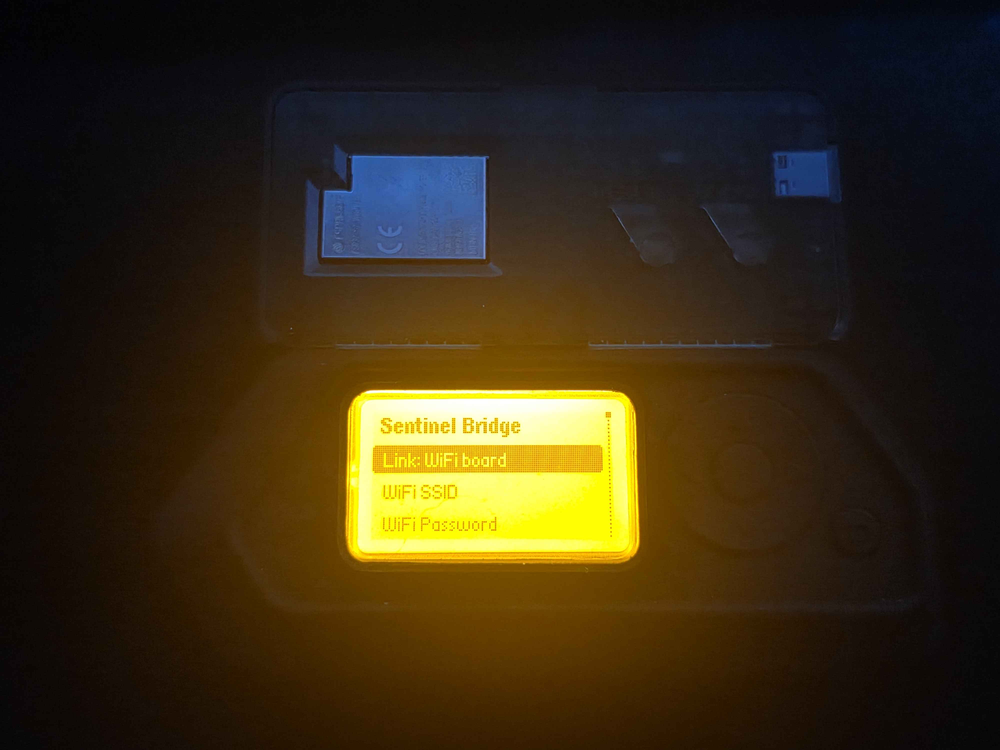
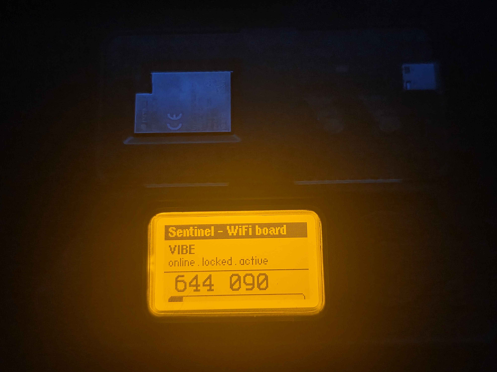
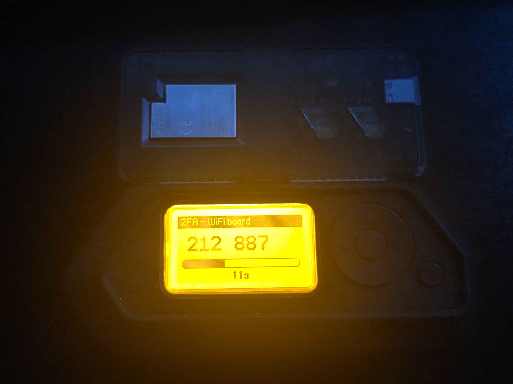

# Sentinel Bridge — Flipper Zero app

Control a self-hosted **Sentinel** relay from a Flipper Zero: lock the PC, drop the 2FA-gated secure lock,
toggle away mode, grab a screenshot, and read the live TOTP code — all from your pocket.

The Flipper holds **no secrets**. It draws the menu, sends a short command line, and renders whatever
state the phone returns. The phone keeps the relay token and the TOTP secret and does the network work.

| | |
|---|---|
| **App id** | `sentinel_flipper` |
| **Version** | 1.1 |
| **Firmware API** | 87.1 (official firmware, Momentum and derivatives) |
| **Category** | Applications → GPIO → **Sentinel Bridge** |
| **Requires** | Sentinel phone app 1.2.5+ |

---

## Screenshots

<table>
  <tr>
    <td width="33%"></td>
    <td width="33%"></td>
    <td width="33%"></td>
  </tr>
  <tr>
    <td align="center"><sub><b>Menu</b> — transport and actions</sub></td>
    <td align="center"><sub><b>Status</b> — name, state, code</sub></td>
    <td align="center"><sub><b>2FA</b> — code, bar, seconds</sub></td>
  </tr>
</table>

---

## Two transports

| Mode | Needs | Works when the phone is away? |
|---|---|---|
| **Bluetooth** (default) | Sentinel phone app in range | No — the phone *is* the network |
| **WiFi board** (optional) | ESP32 devboard + WiFi | Yes — the board talks to the relay |

```
Bluetooth:  Flipper  ──BLE serial──  Sentinel phone app  ──HTTPS──  relay
WiFi board: Flipper  ──UART 13/14──  ESP32 devboard      ──HTTPS──  relay
```

Switch modes from the first menu entry (**Link: Bluetooth** / **Link: WiFi board**). The choice is saved
in `/ext/apps_data/sentinel_flipper/config.txt`.

In Bluetooth mode the WiFi/relay/pair-code entries disappear: there is nothing to configure on the
Flipper, and nothing sensitive stored on it.

---

## Install

### Prebuilt (recommended)

Download `Sentinel-Flipper-1.1.0.fap` from the
[flipper-v1.1.0 release](https://github.com/WhatAVibe/Sentinel/releases/tag/flipper-v1.1.0) and copy it to
`/ext/apps/GPIO/`, or use qFlipper: **File manager → apps → GPIO → install from file**.

The same release carries prebuilt firmware for the optional WiFi boards:

| Asset | Board | Flash offset |
|---|---|---|
| `Sentinel-ESP32S2-1.1.bin` | official WiFi Devboard (ESP32-S2-WROVER, 4 MB) | `0x0` |
| `Sentinel-ESP32-1.1.bin` | classic ESP32 Dev Module (4 MB) | `0x0` |

```bash
esptool --chip esp32s2 write_flash 0x0 Sentinel-ESP32S2-1.1.bin
esptool --chip esp32   write_flash 0x0 Sentinel-ESP32-1.1.bin
```

Each is a merged image (bootloader + partition table + application), so one write is enough for a blank
board.

### From source

Requires [`ufbt`](https://pypi.org/project/ufbt/) (`pip install ufbt`) and the Flipper Zero SDK.

```bash
cd flipper
ufbt            # builds dist/sentinel_flipper.fap
ufbt launch     # builds, uploads and starts it over USB
```

`ufbt update && ufbt` pulls the SDK for your firmware if `ufbt` complains about the API version.
qFlipper locks the USB port — close it before `ufbt launch`.

---

## Bluetooth setup

1. **Flipper:** Applications → GPIO → **Sentinel Bridge**. It starts in **Link: Bluetooth** and shows
   *Bluetooth advertising*. Leave the app open; it only answers the phone while it is running.
2. **Phone:** Settings → **Flipper** → **Set up** → **Scan for Flipper**.
3. Pick your Flipper (watch icon, usually `Flipper` or a custom BLE name). Accept the Android pairing
   prompt; if the Flipper shows a six-digit PIN, type it on the phone.
4. The bridge performs a `PING`/`PONG` handshake, then the status screen fills in with the PC name, the
   current 2FA code and the countdown.

Close **qFlipper** while the bridge is in use: the firmware hands the BLE serial profile to qFlipper's RPC
session whenever something connects, and the app claims it back only on its own connection.

### Link handling

- The Flipper sends `PING` every 10 s while connected; the phone answers `PONG`.
- If the phone sees no traffic for 22 s it treats the link as dead even when Android still reports
  "connected", and reconnects on its own (six attempts, 2–8 s apart, re-subscribing each time).
- If the Flipper app is not running, the handshake fails and the phone says
  *"No answer from the Flipper. Open Sentinel Bridge on it and try again."* rather than pretending to work.
- Back from the status screen returns to the menu; back from the menu leaves the app.

---

## Menu

| Entry | Sends | Result |
|---|---|---|
| Link: Bluetooth / WiFi board | — | Switches transport (saved) |
| Connect | `STATUS` | Opens the status panel and asks the phone for state |
| 2FA Code | — | Full-screen code: large digits, seconds, shrinking bar |
| Lock PC | `LOCK` | `lock` |
| Secure Lock | `SECURE` | `lock_screen` with a message |
| Away On/Off | `AWAY` | `away_enable` / `away_disable` (TOTP handled by the phone) |
| Unlock PC | `UNLOCK` | `unlock_screen` when secure-locked, else `unlock` |
| Screenshot | `SHOT` | `screenshot` |
| Refresh Status | `STATUS` | Re-reads state |
| Forget Pairing | `FORGET` | WiFi board mode only |
| Status Log | — | Scrollable log panel (Up/Down) with the transport in the header |
| Exit | — | Closes the app and releases BLE |

Three screens, each with one job:

- **Status** — PC name, `online / away / locked / session`, the code, and the last action result.
  **OK** jumps to the log.
- **2FA** — only the code. Large digits, the remaining seconds counted down every second, and a progress
  bar that shrinks to zero. Nothing scrolls.
- **Log** — raw `INFO`/`ERR` lines, wrapped to the panel width, with its own scroll position that never
  moves on its own.

Back returns to the menu from any of them; back on the menu leaves the app.

---

## Line protocol

Newline-terminated ASCII over the Flipper BLE serial profile (or UART at 115200). One command per line,
512 bytes maximum.

**Flipper → phone**

| Line | Meaning |
|---|---|
| `PING` | Keep-alive; the phone answers `PONG` |
| `STATUS` | Send current state |
| `LOCK` / `SECURE` / `SHOT` | `lock` / `lock_screen` / `screenshot` |
| `UNLOCK` / `AWAY` | Unlock (TOTP from the phone) / toggle away mode |

**Phone → Flipper**

| Line | Meaning |
|---|---|
| `PONG` | Answer to `PING` |
| `INFO|<text>` | Human-readable progress, e.g. `sent screenshot` |
| `ERR|<text>` | Failure shown as `! <text>` in the status log |
| `STATE|online|away|secure|session|code|seconds|name` | Full state, pushed every 12 s while connected |

BLE identifiers (stock Flipper serial service, the same one qFlipper uses):

| | UUID |
|---|---|
| Service | `8fe5b3d5-2e7f-4a98-2a48-7acc60fe0000` |
| Flipper → phone (TX, indications) | `19ed82ae-ed21-4c9d-4145-228e61fe0000` |
| Phone → Flipper (RX, write) | `19ed82ae-ed21-4c9d-4145-228e62fe0000` |

---

## Optional WiFi board mode

Only needed if you want the Flipper to work without the phone. The ESP32 keeps the relay token in NVS,
does the HTTPS work itself, and talks to the Flipper over UART at 115200 baud.

Two build targets are included:

| Target | Board | UART to the Flipper |
|---|---|---|
| `esp32dev` | classic ESP32 Dev Module | UART0: RX **GPIO3**, TX **GPIO1** |
| `esp32s2` | official WiFi Devboard (ESP32-S2-WROVER, 4 MB) | UART0: RX **GPIO44**, TX **GPIO43** |

Wiring for a classic ESP32 board:

| Flipper GPIO | ESP32 |
|---|---|
| 13 (TX) | RX (GPIO3) |
| 14 (RX) | TX (GPIO1) |
| GND | GND |

The official devboard already routes 43/44 to the header, so it just plugs in.

### Flashing

```bash
cd flipper/esp32
pio run -e esp32dev -t upload          # or: -e esp32s2
```

Or flash the merged image from the release with a single `esptool write_flash 0x0 …` (see **Install**
above). On the S2 board, hold **BOOT**, tap **RESET**, release **BOOT** if the upload cannot open the port.
The firmware keeps USB CDC enabled, so the board normally enumerates as a serial port and can be flashed
again without touching the buttons.

### Building the release images

```bash
cd flipper/esp32
pio run -e esp32s2 && pio run -e esp32dev

python -m esptool --chip esp32s2 merge-bin -o Sentinel-ESP32S2-1.1.bin \
  --flash-mode dio --flash-size 4MB \
  0x1000 .pio/build/esp32s2/bootloader.bin \
  0x8000 .pio/build/esp32s2/partitions.bin \
  0x10000 .pio/build/esp32s2/firmware.bin

python -m esptool --chip esp32 merge-bin -o Sentinel-ESP32-1.1.bin \
  --flash-mode dio --flash-size 4MB \
  0x1000 .pio/build/esp32dev/bootloader.bin \
  0x8000 .pio/build/esp32dev/partitions.bin \
  0xe000 "$HOME/.platformio/packages/framework-arduinoespressif32/tools/partitions/boot_app0.bin" \
  0x10000 .pio/build/esp32dev/firmware.bin
```

### Configuring without the Flipper

The S2 build mirrors the protocol on USB, so the bridge can be set up from any serial terminal at 115200:

```
SSID:YourNetwork
PASS:your-password
URL:https://sentinel.your-domain.tld
PAIR:ABC123          # six-character code from PC -> Settings -> Pair another phone
CONNECT
STATUS
```

The classic build uses the same commands, but only on the UART the Flipper is attached to. Configure it
either way, or from the Flipper: **Link: WiFi board**, fill in SSID/password, relay URL and the pairing
code, then **Connect** and **Pair / Re-pair**.

The ESP32 uses `setInsecure()` for HTTPS, so treat the board (and its NVS) as a trusted device.

---

## Security

- Bluetooth mode stores **no token and no TOTP secret on the Flipper**. The phone holds both; the Flipper
  is a remote keypad. Someone who steals it cannot reach the relay without your phone.
- The BLE link uses the bonded Flipper serial profile: pairing shows a PIN on the Flipper and requires it
  on the phone.
- WiFi board mode stores the token in the ESP32's NVS. Revoke that phone entry from **Linked phones** if
  the board is lost.
- The WiFi password is kept in the ESP32's NVS and, in WiFi board mode, also in
  `/ext/apps_data/sentinel_flipper/config.txt` on the Flipper's SD card **in plain text** (the Flipper needs
  it to send the configuration to the board). Treat the card as sensitive, or configure the board over USB
  instead and leave the Flipper's WiFi fields empty.
- Sentinel is for devices you own. Ctrl+Alt+Del cannot be blocked by the PC agent and a local
  administrator can stop it — see the [security model](../docs/SECURITY.md).

---

## Troubleshooting

| Symptom | Fix |
|---|---|
| Flipper never appears in the phone's scan | Open Sentinel Bridge on the Flipper, keep it on Link: Bluetooth, and close qFlipper. |
| *"No answer from the Flipper"* | The Flipper is running its stock serial profile — open Sentinel Bridge on it and tap Reconnect. |
| Pairing fails | Remove the Flipper bond in Android Bluetooth settings, restart the phone app, pair again. |
| `Bluetooth not connected` on the Flipper | Connect from **Settings → Flipper** on the phone. |
| Status says `No paired PC` | Pair a PC in the phone app first. |
| `Bluetooth serial profile unavailable` | Another app (qFlipper) owns the BLE profile. Close it and reopen Sentinel Bridge. |
| Actions do nothing | Check relay access on the phone; the Flipper shows the phone's `ERR` line verbatim. |
| Drops every so often | The phone reconnects by itself; keep Sentinel Bridge open. |
| WiFi board: `set WiFi SSID first` | Fill in credentials, press **Connect**, then **Pair / Re-pair**. |
| WiFi board: TOTP blank | The ESP32 cannot reach NTP (UDP 123); check the WiFi/firewall. |

A rolling log of the last BLE session is kept at `/ext/apps_data/sentinel_flipper/trace.log`
(rotated at 8 KB, no secrets). It records menu picks, view switches, BLE connect/disconnect, `INFO`/`ERR`
lines and send results — attach it when reporting a bug.

---

## Source layout

```
flipper/
├─ application.fam        FAP manifest (id, version, stack, category)
├─ src/
│  ├─ sentinel_app.c      UI, menu, config, state rendering, lifecycle
│  ├─ sentinel_link.c     BLE serial + UART transports, line framing
│  └─ sentinel_link.h
├─ esp32/                 optional standalone WiFi bridge
│  ├─ platformio.ini      esp32dev + esp32s2 targets
│  └─ src/sentinel_bridge.ino
└─ dist/                  built .fap
```

Implementation notes:

- The UI is a `ViewDispatcher` with five views: submenu, text input, **Status**, **2FA** and **Log**. Back
  is handled through a dispatcher navigation callback that posts a custom event, so no view is switched
  from inside an input callback.
- The RX worker thread only queues bytes and posts an event; all rendering happens on the GUI thread.
- On `BtStatusConnected` the app re-registers its serial event callback. The firmware's BT service opens a
  qFlipper RPC session on every connection and would otherwise consume the phone's writes and the TX
  channel.

### Design notes

Earlier builds pushed everything — the PC name, the TOTP code, *and* every `INFO`/`ERR` line — through a
single scrolling `TextBox`. It looked like a terminal, it auto-scrolled like a terminal, and it could crash
like one too: the box keeps the **raw pointer** it is handed (`text_box_set_text` does not copy), and it was
pointed at a `FuriString` buffer that we reset and rebuilt on every incoming line. A redraw that landed
after the next rebuild read moved or freed memory — on-device that shows up as a bare
"NULL pointer dereference" rather than anything specific.

1.1 removes that whole class of problem:

- **Status** is a hand-drawn panel (its own `View` + draw callback) fed from a fixed-size `StatusModel`
  struct: PC name, online/away/locked, session, the code and a countdown bar. Press **OK** to jump to the
  Log.
- **2FA** is another hand-drawn panel with a `CodeModel` and nothing else on it: large digits, the seconds
  remaining (the 1 s dispatcher tick decrements it locally and pushes the model), and a progress bar that
  shrinks to zero.
- **Log** is now a custom view with its own scroll offset and a `char[2048]` buffer we own for the life of
  the app. Rows are pre-wrapped when the log changes, the header shows the transport, and new lines never
  move the view — Up/Down scroll it.
- Every callback that can be reached from the link worker or the BT stack checks a `volatile bool alive`
  flag, and the BLE serial callback is unhooked before the profile is restored on exit.

If you still hit a crash, the rolling `trace.log` (see **Troubleshooting** above) records the last menu
picks, view switches and teardown steps before it happened — attach it when reporting.
